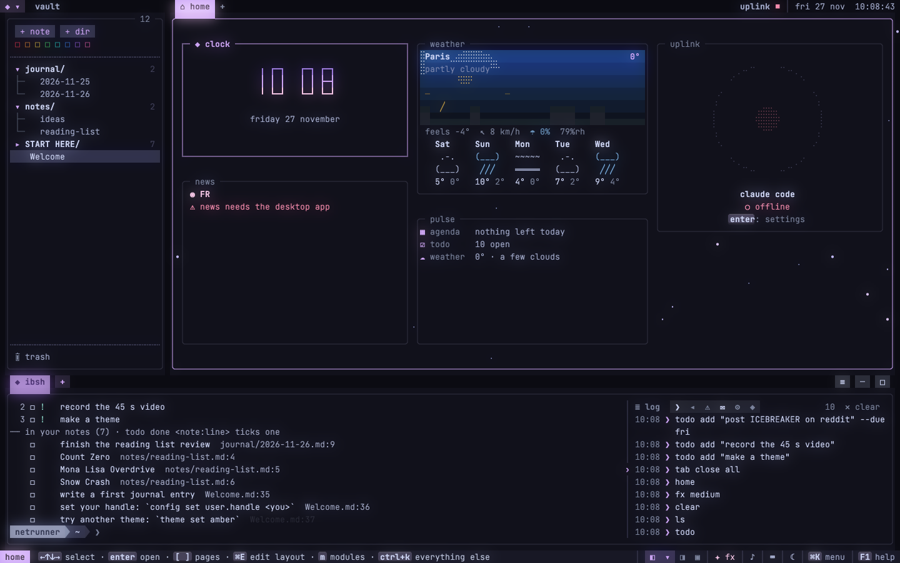
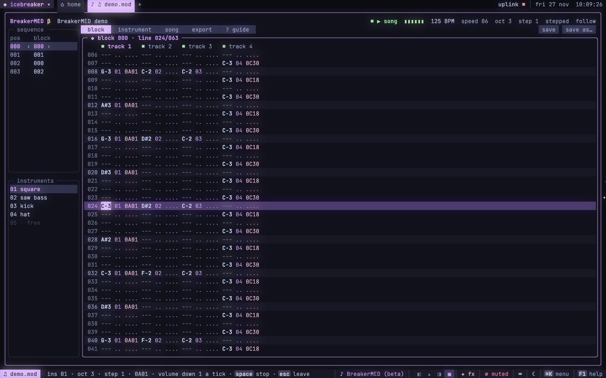
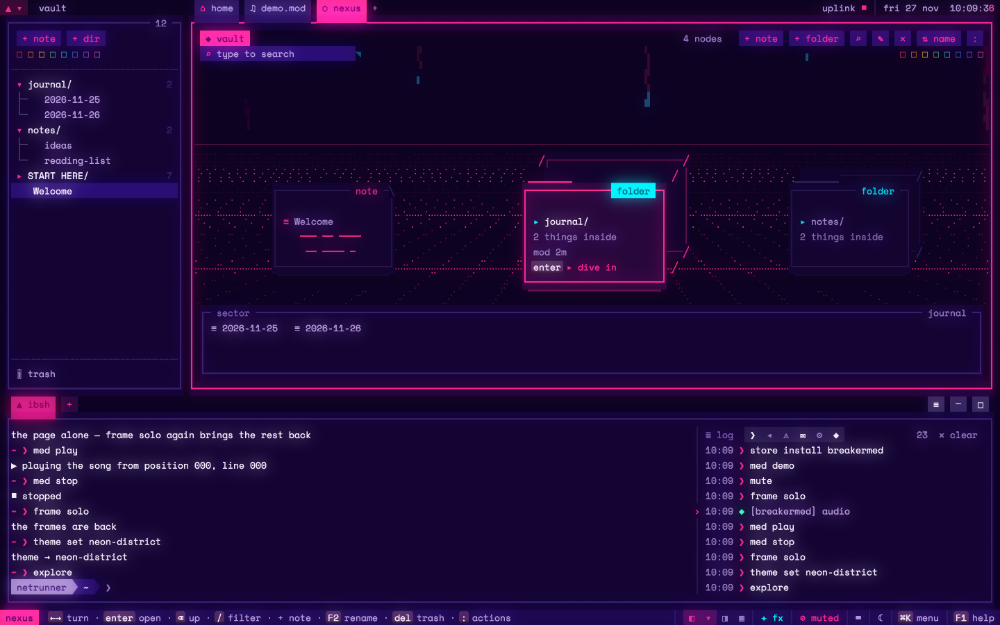
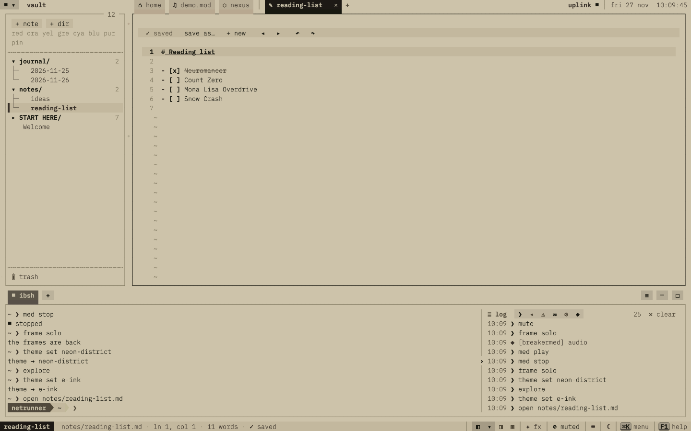

```
██╗ ██████╗███████╗██████╗ ██████╗ ███████╗ █████╗ ██╗  ██╗███████╗██████╗
██║██╔════╝██╔════╝██╔══██╗██╔══██╗██╔════╝██╔══██╗██║ ██╔╝██╔════╝██╔══██╗
██║██║     █████╗  ██████╔╝██████╔╝█████╗  ███████║█████╔╝ █████╗  ██████╔╝
██║██║     ██╔══╝  ██╔══██╗██╔══██╗██╔══╝  ██╔══██║██╔═██╗ ██╔══╝  ██╔══██╗
██║╚██████╗███████╗██████╔╝██║  ██║███████╗██║  ██║██║  ██╗███████╗██║  ██║
╚═╝ ╚═════╝╚══════╝╚═════╝ ╚═╝  ╚═╝╚══════╝╚═╝  ╚═╝╚═╝  ╚═╝╚══════╝╚═╝  ╚═╝
```


**A cyberdeck from a cyberpunk movie, for your notes, your journal and your music.**
A free, open-source desktop app (Windows · macOS · Linux), drawn entirely in characters — glow,
scanlines, a boot sequence — that you drive with the keyboard, the mouse or a gamepad.



<table><tr>
<td></td>
<td></td>
<td></td>
</tr><tr>
<td align="center"><sub>BreakerMED: an Amiga-style music tracker, as a module</sub></td>
<td align="center"><sub>NEXUS, in the neon-district theme</sub></td>
<td align="center"><sub>a note, in the e-ink theme</sub></td>
</tr></table>

### Why it exists

I'm not a developer. I'm making ICEBREAKER because I think this kind of software is fun and I
wanted one for myself; an AI (Claude) writes most of the code, I decide what it should be and test
it a lot. Maybe it'll interest a few other people — and **everyone can join in**: try it, break it,
suggest things, make a module or a theme. Bugs and ideas in English or French
([Issues](https://github.com/kiddoko/ICEBREAKER/issues),
[Discussions](https://github.com/kiddoko/ICEBREAKER/discussions), [CONTRIBUTING.md](CONTRIBUTING.md)).

A good example of what a module can be: **BreakerMED**, a music tracker in the spirit of the old
Amiga trackers (OctaMED), with an 8-bit "vintage" mode — completely useless for taking notes, and
that's the point. Install it from the STORE (`store install breakermed`, then `med demo`).

> [!CAUTION]
> ## ⚠ Test software — read this before you use it
>
> ICEBREAKER is a **hobby project in testing**, vibe-coded by one person who isn't a
> developer, with an AI (Claude) writing most of the code. It has **never been audited**.
> **It is not ready for heavy, secure or professional use.**
>
> - **Store nothing sensitive in it** — no passwords, banking, medical, legal or confidential
>   documents — *encrypted vault or not*.
> - **Back up your vault regularly** (it's a folder: copy it). A bug can lose notes.
> - **No warranty, no support**: the author isn't responsible for bugs, data loss or security
>   problems. You use it at your own risk ([DISCLAIMER.md](DISCLAIMER.md), [LICENSE](LICENSE)).
> - What was found, fixed and what is still open, honestly: [docs/SECURITY_AUDIT.md](docs/SECURITY_AUDIT.md).
>
> **You can help — that's the point of making it public:** report bugs and tell us how it went
> ([Issues](https://github.com/kiddoko/ICEBREAKER/issues)), share ideas and feedback
> ([Discussions](https://github.com/kiddoko/ICEBREAKER/discussions)), make **modules and themes**
> ([docs/PLUGINS.md](docs/PLUGINS.md), [docs/THEMES.md](docs/THEMES.md), [the STORE's repository](https://github.com/kiddoko/icebreaker-modules)),
> review the code ([docs/REVIEWING.md](docs/REVIEWING.md)).
>
> *En français : logiciel de test, fait par un non-développeur avec une IA, jamais audité, pas
> prêt pour un usage intensif, sécurisé ou professionnel. N'y mets rien de sensible, sauvegarde
> ton vault souvent, et dis-nous ce qui casse — [DISCLAIMER.md](DISCLAIMER.md).*

## What's inside

### Your notes
- **Plain Markdown**, an Obsidian-compatible vault (`[[wikilinks]]`, `#tags`, frontmatter) — or point it at the vault you already have.
- **Journal**: one file per day, a calendar, streaks; `journal` opens today, `journal "…"` adds a line from the shell; `daily` asks a short end-of-day check-in.
- **The tree**: one click selects, a double-click opens; drag & drop, colour tags and icons, pins at the top, shift + wheel to walk file by file with a live preview.
- **Notes**: a toolbar (save, save as, new, previous / next, undo, redo), a red dot while unsaved, `⌘S`. A note changed elsewhere (Obsidian, a sync) reloads by itself, and never overwrites your unsaved edits.
- **Undo anything** with `⌘Z` / `Ctrl+Z` — a setting, a widget moved, a file sent to the trash, a rename. The **trash** is a page you can browse and restore from; nothing is ever deleted for good from inside the deck.
- **NEXUS**: walk your vault in pseudo-3D — files on an endless ring above a synthwave floor (`explore`).

### HOME and the side panel
- **Widgets** anywhere on HOME, gaps included, on several pages; drag them, pull a corner to resize, open one for its pop-up and settings. TODO, REMINDERS and HABITS entries are edited and removed right in their widget. The **same widget several times**, each copy with its own settings (two clocks, two news feeds…).
- **The side panel** (◨): widgets that stay in view on every page, edited together with HOME.
- **Pins and shortcut squares are one list**: pin a note, folder, module, page, macro or command — it shows at the top of the tree, in the pinned widget, and as a square on HOME if you like.
- **PULSE**: one widget for what's happening — the next event, tasks due, reminders, music, focus, weather, errors.

### The shell
- **Your real terminal** (zsh / bash / fish, or PowerShell on Windows) in tabs, with your profile and prompt, every ICEBREAKER command added (`todo add …`, `theme set …`), and macros one click away.
- **ibsh**, the deck's own shell: pipes, redirections, globs, history, 70+ commands on your vault — `cat note.md | ask "summarize"` works.
- **Every click is a command**: the log (on the shell's right, or its tab) shows what your clicks ran, errors (with a code, see [docs/ERRORS.md](docs/ERRORS.md)) and notifications.

### UPLINK, the AI (optional)
- Chat with **Claude** (Claude Code or an API key) or a **local model through [Ollama](https://ollama.com)**. It can search, read and — when you ask — write notes, inside the vault only.
- Several conversations in tabs; each message says who wrote it.
- A **context page** it reads before every conversation (`context`): who you are, how it should talk to you, how your vault is organised — built by the deck, no AI involved.
- The **voice** reads answers while they're written, in English, French — or Japanese, for the full cyberpunk effect. Local open-source voices (sherpa-onnx): nothing leaves your computer. You choose what else it says aloud (errors, reminders, your next event…).

### Modules
- **Everything is a module**, apart from the frame (HOME, notes, the tree, the command engine, settings): TODO, CALENDAR (local + Google), HABITS, REMINDERS, STATS, MUSIC, WEATHER, CLOCKS, FOCUS, NEWS, NEXUS, UPLINK, the TERMINAL itself… — every one listed in the STORE, so a removed one comes back from there. Modules can need other modules (installed and switched on with them), and **ICEBREAKER and its modules update themselves** (Settings → UPDATES: every day, download by itself, install by itself or ask first — signed updates, nothing in stealth mode). Switch them off, remove them, reinstall them from the **STORE** (modules and themes from the [community index](https://github.com/kiddoko/icebreaker-modules) or your own server).
- **MODULES** shows them on a turning ring, each one a cyberdeck shard in its colour.
- **From the STORE**: **BreakerMED**, a 4–8 track music tracker (samples, synths, an Amiga / Akai vintage mode, `.mod` / `.med` import, WAV export) — and yours next ([docs/PLUGINS.md](docs/PLUGINS.md)).
- Modules have a documented API and declared permissions; the built-in ones use the very same API ([docs/PLUGINS.md](docs/PLUGINS.md)). Everything is callable: `ib.use("tree").reveal("notes/a.md")`.
- **Modules from the STORE run in a sandbox** (a Worker: no page, no native side, no network of their own — only what their permissions allow; [docs/SANDBOX.md](docs/SANDBOX.md)).
- **Permissions in plain words**: what a module, the AI or a program in your terminal may reach has a name, a level and a switch — the riskiest asked again when first used, every one shown with its last use and taken away in one click (Settings → PERMISSIONS, [docs/PERMISSIONS.md](docs/PERMISSIONS.md)).
- **One UI kit**: the field, the checkbox, the slider, the list, the file browser… exist once and modules get the same ones ([docs/UI_KIT.md](docs/UI_KIT.md), spacing rules: [docs/LAYOUT.md](docs/LAYOUT.md)).

### Look and feel
- **11 themes**, each with its colours, font, animated background, sounds, widget frames and screensaver — from e-ink (matte paper) to neon-district (synthwave) and abyss (bioluminescent sonar). Make your own in a `.toml` file or the theme studio ([docs/THEMES.md](docs/THEMES.md)).
- **Effects**: one slider each for bloom, scanlines, vignette, RGB split, glow and sharpness, or a preset (none · light · medium · heavy · party).
- **Smooth**: vertical sync up to 120 Hz, letters that fade in as they appear, text that types itself out with a little blip; or *reduce motion* for slower machines. Nothing is drawn when nothing moves, and a deck left alone slows its animations to 2 frames a second.
- **Screen readers**: the deck draws in a canvas, so it isn't usable with a screen reader yet; it does announce its notifications and the page that comes in front.
- **Sounds**: synthesized UI blips in 7 packs, a mixer, optional keyboard clicks; your own sound files too ([docs/SOUND_PACKS.md](docs/SOUND_PACKS.md)).
- **THE MENU** (`⌘K` or shift twice) searches everything; every shortcut is listed (`⌘/`) and can be changed; right-click works everywhere.
- **English or French**, chosen at setup. A **guided tour** after the setup (`tour` plays it again).
- **Docs in your vault**: START HERE/ (the tour, modules, interface, shell, keys, the AI, privacy), in English or French — the deck's language — written into every vault and kept up to date; `starthere dev` adds FOR DEVELOPERS/ (themes, the module API).
- **Frames you arrange**: the tree, the page, the side panel and the shell, each with its tabs on its border — drag a tab onto any frame, group tabs, resize or fold a frame, presets (`layout preset`, in ibsh), ⌘Z / Ctrl+Z. The top row holds the tabs, with **◆ icebreaker ▾** (the deck's menu: MODULES, STORE, NEXUS, settings, help, log out — **◆ ▾** in a narrow window) in its left corner and UPLINK ■ and the clock in its right one. **HOME** is pinned, always the first tab.
- **Wake-up alarms** (`clock alarm 7:30 --days mon-fri`): a full screen rings, with the sound and a notification, while ICEBREAKER runs. **MOON** has its own page (the moon drawn, the month in moons), **NEWS** too (each widget shows one thing: your area, your country, categories or your own words), **SYSMON** shows the busiest programs, the disks and the network.
- **Picks up where you left**: tabs (in their frames), open folders and the page you were on come back at the next start. Mouse back / forward and a two-finger swipe switch tabs; pinch zooms.

### Accounts and privacy
- **Accounts**: each one is its own deck — settings, theme, sounds, vault, Google connection — behind its password (Argon2id, never stored). It locks the app; its vault can also be encrypted (`vault encrypt`: names, folders and notes, XChaCha20-Poly1305, the key opened by your password — [docs/ENCRYPTION.md](docs/ENCRYPTION.md); a plain backup zip is made first, `vault decrypt` and `vault export <folder>` give plain files back). It also gives a **recovery key** (24 words, shown once, one asked back): forgot the password → login page → *forgot password?*; `vault recovery` makes a new one, `vault rekey` a new key for the whole vault (everything encrypted again). Encryption is an option (the setup asks, Settings → PRIVACY switches it, either way, as often as you like).
- **Move your vault** (Settings → VAULT → *Move vault*, `vault move`): everything copied and checked, then used; the old folder goes only if you say so.
- **Modules can't touch the encryption** (nor your account's files in the vault, nor pose as the deck's or another module's commands), run with the permissions you approved and nothing more — in the shell too — and say who they are when they ask you something ([docs/SECURITY_AUDIT.md](docs/SECURITY_AUDIT.md): what was found, fixed, and what's still open).
- **Portable vault**: the vault carries its account and settings. On another computer — Mac, Windows, Linux, a USB key — login page → *open a vault*: its folder, the account's name and password (or its 24 words). Forgot a password? Quit, remove that account from `accounts.json` in the config folder (macOS: `~/Library/Application Support/org.icebreaker.deck/`); its settings stay in `users/<id>/`.
- **Stealth mode** (`stealth on`): 100 % local, no internet at all.

> [!WARNING]
> **Not for sensitive documents.** ICEBREAKER is a hobby project, made with care
> but without any security audit. Your notes are plain files on your disk unless
> you encrypt the vault (`vault encrypt`: new, home-made on well-known libraries, not
> reviewed by experts). Don't use it to keep passwords, medical, legal, financial or
> other sensitive documents. Use it at your own risk — [DISCLAIMER.md](DISCLAIMER.md),
> and the [license](LICENSE): no warranty of any kind.

## Yours, offline, anonymous — if you want

ICEBREAKER offers tools; it never requires them. You can keep **everything in
your vault** — notes, journal, calendar, tasks, music library — stay **offline**,
use **no account** and **no AI**, and the deck works the same.

- Your data is plain files on your disk (Markdown, TOML, JSON). Open them with anything; sync them with anything — or don't.
- Nothing phones home. There is no ICEBREAKER server and no telemetry.
- Network traffic only goes to the services a feature names: the AI provider you choose (or a local model with Ollama), the weather widget (open-meteo.com, no account), news feeds, Google Calendar if you connect it, and GitHub — when you install a module or theme, and once a day to look for updates (Settings → UPDATES: *never* switches that off; **stealth mode** switches everything off).
- Google data, if you connect it, is never written into your vault (so no AI or sync tool sees it), and `cal google disconnect` removes it. See the [privacy policy](docs/PRIVACY.md).

## Install

Download the latest build for your system from the **Releases** page (or from the
latest successful **Actions → build** run): `.zip` for macOS, `.exe` installer
for Windows, `.AppImage` / `.deb` for Linux. Builds run for release tags and on
demand (`gh workflow run build.yml`), not on every push.

- **Tested on macOS and Windows** (a Windows PC tests every change: install, updates, encryption,
  the sandbox). **Linux** runs the same code but is tested less: tell us how it goes.
- **macOS**: the app isn't notarized yet. The first time, right-click it → *Open*
  (or run `xattr -dr com.apple.quarantine ICEBREAKER.app`).
- **Windows**: SmartScreen may warn about an unknown publisher → *More info* → *Run anyway*.
- **Linux**: the `.deb` for Debian / Ubuntu / Mint (`sudo apt install ./ICEBREAKER_*.deb`), the
  `.AppImage` for the rest (`chmod +x ICEBREAKER_*.AppImage`, then run it; it needs FUSE 2 —
  `libfuse2` / `fuse2` — or run it with `--appimage-extract-and-run`). It uses your system's
  GLib and WebKitGTK plays sound through **GStreamer**: no sound? install its plugins —
  Arch `sudo pacman -S gst-plugins-base gst-plugins-good`, Fedora
  `sudo dnf install gstreamer1-plugins-base gstreamer1-plugins-good`, Debian / Ubuntu
  `sudo apt install gstreamer1.0-plugins-base gstreamer1.0-plugins-good`.

Then follow the first-run setup — every question can be skipped. New to the deck?
Read **[Getting started](docs/GETTING_STARTED.md)**.

## Build from source

Requirements: [Node.js](https://nodejs.org) 20+, [Rust](https://rustup.rs), and the [Tauri prerequisites](https://tauri.app/start/prerequisites/) for your OS (WebView2 on Windows is already there; on Linux `webkit2gtk-4.1`).

```bash
npm install
npm run app          # desktop app, dev mode (hot reload)
npm run app:build    # release build + installers in src-tauri/target/release/bundle
npm run dev          # UI only, in your browser, with a demo vault (no Rust needed)
```

First launch creates a vault in `Documents/Icebreaker`. To use an existing Obsidian vault: `vault mount /path/to/vault` in the shell, or Settings → vault folder.

To talk to Claude: get an API key at [console.anthropic.com](https://console.anthropic.com), then `config key` (or set `ANTHROPIC_API_KEY`). For a fully offline setup: install Ollama, `ollama pull llama3.1`, then `config set ai.provider ollama`.

## Controls (short version — `F1` in the app for the full manual)

| | keyboard | gamepad |
|---|---|---|
| THE MENU: search everything, or a key + enter | `Ctrl+K` (⌘K) · `Shift` twice (anywhere, even typing) | hold RB · Y |
| today's journal / new note | `Ctrl+J` / `Ctrl+N` | — |
| UPLINK, the AI | `Ctrl+Shift+U` · `Ctrl+Space` | — |
| tree · side panel · shell | `Ctrl+Shift+T` / `Ctrl+B` · `Ctrl+Shift+P` · ``Ctrl+` `` / `Ctrl+Shift+S` | — |
| the deck's menu (MODULES, STORE, NEXUS, settings, log out) | `F10` or a click on **◆ ▾**, top left | — |
| a tab into another frame · a group | drag it onto the frame · onto another tab (or right-click → *Move to*) | — |
| HOME · MODULES · NEXUS | `Ctrl+Shift+H` · `Ctrl+Shift+M` · `Ctrl+Shift+E` | Start (HOME) |
| macros · effects | `Ctrl+Shift+K` · `Ctrl+Shift+F` | — |
| shell | ``Ctrl+` `` (key under Esc) | Select (switch pane) |
| move between panes | `Alt+←↑↓→` | Select |
| tabs | `Ctrl+1…9`, `Ctrl+Tab`, `Ctrl+W` | LB / RB (tap) |
| undo / redo anything | `Ctrl+Z` / `Ctrl+Shift+Z` (⌘Z / ⌘⇧Z) | — |
| put anything on THE MENU | right-click → *Add to THE MENU…* · `menu add <key> "<cmd>"` | — |
| on-screen keyboard | status bar `⌨` | X |
| interface scale (25–200 %) / fullscreen | `Ctrl+=` `Ctrl+-` `Ctrl+0` / `F11` | — |
| back to HOME | `Ctrl+Shift+H` (or `h` where letters aren't typed or searched) | Start |

Every setting can go back to its default: ↺ next to it, or a button per category (`config reset <key>`). Every click runs the matching shell command (the LOG tab shows it): the mouse teaches you the command line (hover anything to see its command and shortcut). `Esc` closes the page you're on and goes back to the previous one. The mouse works everywhere: tabs, tree, tiles, calendar, buttons, drag-to-select, drag the shell border to resize.

## Reading the code

The codebase is meant to be read. Start at [`src/deck.ts`](src/deck.ts) (where everything is wired), then [docs/ARCHITECTURE.md](docs/ARCHITECTURE.md).

```
src/
  main.ts        boot: font, settings, Deck
  deck.ts        composition root — every subsystem is created here
  core/          grid, renderer, glyph atlas, frame loop, input, gamepad, themes, settings
  ui/            immediate-mode drawing toolkit: editor, lists, chat, sliders, keycaps, typewriter
  workspace/     layout, tabs, focus, overlays (THE MENU, dialogs, OSK), boot sequence
  apps/          home, note, journal, link (UPLINK), modules, explorer (NEXUS), settings, help…
  shell/         parser, executor, terminal buffer, commands/; origin.ts + privileged.ts: what a module's line may do
  ai/            Claude (Claude Code, Anthropic API) and Ollama providers, vault tools, prompts, context page
  plugins/       plugin host + the public API (api.ts), the sandbox (sandbox/), the STORE's installer
  platform/      Tauri bridge, or a browser fallback
src-tauri/       Rust: vault file access (sandboxed), encryption (crypto.rs, store.rs), accounts, the terminal, updates
plugins/         built-in plugins (same API as user plugins)
themes/          built-in themes (nightshade.toml is the annotated reference)
```

- Write a plugin → [docs/PLUGINS.md](docs/PLUGINS.md)
- Error codes (E101…) and what to do → [docs/ERRORS.md](docs/ERRORS.md)
- Who made it → [CONTRIBUTORS.md](CONTRIBUTORS.md)
- Make a theme → [docs/THEMES.md](docs/THEMES.md)
- Make a sound pack → [docs/SOUND_PACKS.md](docs/SOUND_PACKS.md)
- The house rules for modules and themes → [docs/GUIDELINES.md](docs/GUIDELINES.md)
- Permissions (the names, the levels, what's asked when) → [docs/PERMISSIONS.md](docs/PERMISSIONS.md)
- Modules and safety (the audit, the sandbox) → [docs/SANDBOX.md](docs/SANDBOX.md) · what was found and fixed → [docs/SECURITY_AUDIT.md](docs/SECURITY_AUDIT.md)
- The UI kit and the spacing rules → [docs/UI_KIT.md](docs/UI_KIT.md) · [docs/LAYOUT.md](docs/LAYOUT.md)
- Share them, install other people's → [docs/COMMUNITY.md](docs/COMMUNITY.md)
- Contribute (ideas, fixes, modules — how a change gets in) → [CONTRIBUTING.md](CONTRIBUTING.md) · report a vulnerability → [SECURITY.md](SECURITY.md)
- What this project is and isn't → [DISCLAIMER.md](DISCLAIMER.md)
- Review the code (where the risk is, how to report) → [docs/REVIEWING.md](docs/REVIEWING.md)
- Updates (in the app, and how releases are made) → [docs/UPDATES.md](docs/UPDATES.md)

## Roadmap

Done so far: notes, journal and modules (0.1–0.5); encryption, portable vaults and the module
sandbox (0.5); frames you arrange and the UI overhaul (0.6–0.7); in **0.8.0**, one top row with
real keys drawn for every shortcut (a gamepad turns them into its buttons), tabs for pages and
documents, modules that open their own files, themes v2 (steps 1–2) and the fixes of two
security passes on the Windows test PC. Next, roughly in this order:

1. **Themes v2** — a theme can restyle every part (done: frames, tabs, buttons, checkboxes,
   sliders, lists, the tree, the caret, tips), protected screens no theme can disguise, a theme
   studio generated from it, then theme packages in the STORE ([docs/THEMES_V2_PLAN.md](docs/THEMES_V2_PLAN.md)).
2. **First contact** — a shorter setup, the deck's words explained once, help easy to find.
3. **STORE and modules** — filters, pages per module, ratings; modules redrawn (music, weather, news…).
4. **Voice and AI** — one voice path, several AIs, tools for local models, an evening journal.
5. **Notes and editors** — backlinks and a graph, tables, a code editor as a module.
6. **Platforms** — notarized macOS, signed Windows installer, more Linux testing.

## License

MIT — see [LICENSE](LICENSE). Nightshade's palette is inspired by [Catppuccin](https://catppuccin.com) (MIT). Font: [JetBrains Mono](https://www.jetbrains.com/lp/mono/) (OFL).
